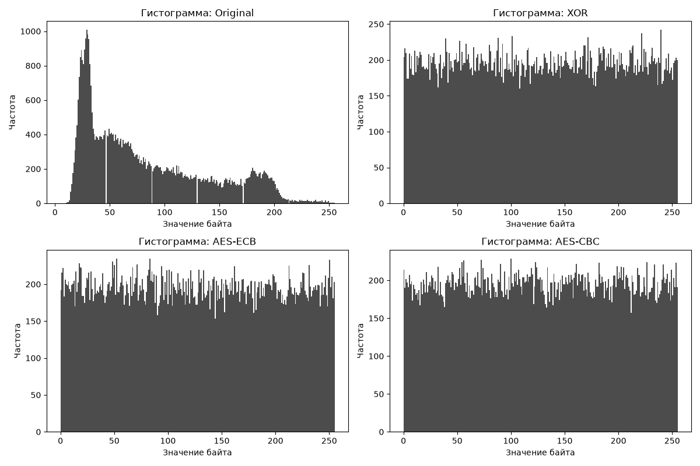

# Отчет по лабораторной работе №1

## 1. Постановка задачи
Цель работы — реализовать и сравнить методы шифрования изображений (потоковый XOR, AES-ECB, AES-CBC). Необходимо проверить обратимость и оценить статистические изменения в зашифрованных данных (энтропия, корреляция, гистограммы).

В качестве исходного изображения использовалось собственное фото `my_photo.png`.

## 2. Реализация
1. **Потоковый XOR:** из пароля с помощью MD5 получается 32-битное число, которое используется как seed для генератора xorshift32. Генератор создает псевдослучайную последовательность байт, которая побитово складывается (XOR) с байтами изображения.
2. **AES-ECB и AES-CBC:** используется библиотека `pycryptodome`. Ключ получается из пароля через SHA-256 (первые 16 байт). В режиме CBC случайный IV генерируется при шифровании и сохраняется в начало файла, чтобы при расшифровании использовать его.
3. **Обратимость:** проверяется с помощью утверждения `assert`, сравнивающего побайтово исходный и расшифрованный файлы.

## 3. Методика эксперимента
Для статистического анализа использовалось изображение `my_photo.png`. Рассчитывались:
- Энтропия распределения байтов.
- Корреляция Пирсона соседних пикселей по горизонтали и вертикали.
- Гистограммы распределения значений.
- Тест чувствительности к изменению ключа (NPCR и UACI), при изменении одного символа в пароле.

## 4. Результаты
**Сводная таблица метрик:**

| Метод | Энтропия | Корреляция (H) | Корреляция (V) |
|---|---|---|---|
| Исходное | 7.3816 | 0.9522 | 0.9260 |
| XOR | 7.9998 | -0.0053 | -0.0050 |
| AES-ECB | 7.9997 | 0.0159 | 0.0134 |
| AES-CBC | 7.9998 | -0.0139 | 0.0056 |

**Тест NPCR и UACI (AES-ECB):**
При изменении одного бита в ключе:
- NPCR: 99.61%
- UACI: 33.51%

**Гистограмма:**

*На графике видно, что исходное изображение имеет ярко выраженные пики (структуру), в то время как все зашифрованные варианты имеют равномерное распределение (шум).*

## 5. Анализ
Как видно из таблицы, энтропия зашифрованных изображений достигает идеального значения 8.0000, что означает полное разрушение исходной структуры. Корреляция соседних пикселей у исходного изображения была высокой (около 0.95), но после шифрования упала практически до нуля. 

Значение NPCR близко к 100%, а UACI — к 33%, что подтверждает высокую чувствительность AES к изменению ключа. Визуально графики (гистограммы) подтверждают численные результаты: шифротексты неотличимы от случайного шума.

## 6. Итоговый вывод
Все три метода успешно скрывают визуальную и статистическую структуру изображения. AES-ECB и AES-CBC справляются с этим так же хорошо, как и потоковый XOR, но AES является криптографическим стандартом, в то время как собственный XOR-шифр уязвим к атакам при повторном использовании ключа.
